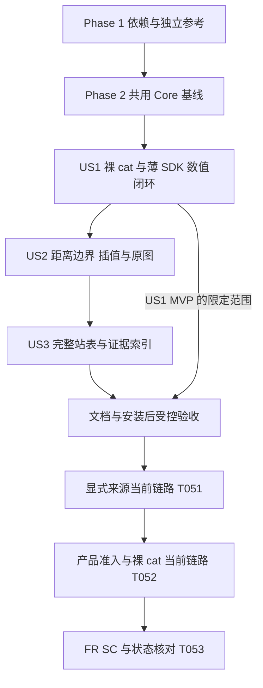

# Tasks: 位置驱动的雷达发现与局部投影预览

**Input**: `specs/006-location-radar-view/` 下的 [spec](spec.md)、[plan](plan.md)、[research](research.md)、[data-model](data-model.md)、[CLI/SDK contract](contracts/cli-sdk.md)、[quickstart](quickstart.md)、[projection](projection.md)、[station-catalog](station-catalog.md)、[station-inventory](station-inventory.md)、[Tropical Globe 核对](tropicalglobe-crosscheck.md)与[旧项目参考](legacy-reference.md)。

**Date**: 2026-10-10。实际 Git 分支 `main`；逻辑 feature `006-location-radar-view`。

**Status**: 已实现；53/53 项已勾选。Core/CLI/Python SDK 局部视图、US2 投影与采样、US3 空间站表索引、安装后 wheel smoke、T027/T036 三入口固定输入回放及 T051/T052 在线链路均有证据。2026-10-24 RainViewer 仅对个人用途 `local_view` 通过裸 `cat` 默认选择（单次、单点运行）；CLI 报告显示来源署名链接。**评审后状态**：代码审查后仍在修改，离线/打包记录早于 T052 准入，SC-001 负向场景与 SC-008 最终核对须在修复后重新验证，之前不称 `verified`（见 roadmap 1.9.3）；测试点及未验收地区的观测覆盖仍标记 unknown。

**Tests**: spec 的三个 Independent Test 和 SC-001–008 均已对照证据。US1 Engine 受控场景、CLI local 路由/报告与旧入口、Python 同步/异步合同和代表回归已执行；2026-10-17 Core 模式/缓存矩阵、投影/采样/目录/证据集成 9 项、CLI 集成 3 项、Python local_view/cat 合同 14 项及固定帧三入口回放 5 项通过，详见 `validation-results/006-local-view-offline.json`。59 个独立投影控制点通过。PT raw RGBA 与 RainViewer decoded/dbz values/quality 均以 SHA-256 在 CLI、同步 SDK、异步 SDK 间精确比对；PT raw 和 SG categorical 均在 auto+bilinear 下经三个入口排除且未触发发现/获取；受控适配器回放不替代真实上游验收。2026-10-24 裸 `cat` 安装 wheel 当前链路和署名输出见 `validation-results/006-local-view-live.json`。正式 constitution 仍为占位，约束以 AGENTS.md、用户要求和本规格为准。

**Organization**: 三个故事均为 P1，按 spec 的 US1 → US2 → US3 排列。Phase 2 只提供各故事共用的原语和数值最近邻基线；US1 不必等待 PT 正向准入或所有历史站址被确认为当前固定站。

## Format 与路径

- 清单格式为 `- [ ] TNNN [P?] [USn?] 描述及仓库相对文件路径`。
- `[P]` 仅表示在本阶段入口条件及所列依赖已完成后，可以与指定的其他任务并行；同文件变更、资源同步和证据汇总顺序执行。
- 现有 Rust Core/CLI、PyO3、薄 SDK 和资源同步流程直接复用；新建路径仅为设计中的局部模块、测试或验收材料，不建立独立站点数据库或获取流水线。
- 新增 Rust 测试函数名含 `local_view`，坐标参考测试同时含 `projection`，使 quickstart 的过滤命令实际收集用例。新增测试路径在实施时创建，不能因当前不存在或零收集而记为通过。

## Phase 1: Setup — 依赖与参考材料

**Purpose**: 为现有 workspace 增加所需测地线依赖和独立坐标参考，不重新初始化项目。

- [X] T001 [P] 在 `Cargo.toml`、`crates/radiust-core/Cargo.toml`、`Cargo.lock` 锁定 `geographiclib-rs` 0.2.7、关闭默认可选 feature，核对 Rust 1.92 构建及许可证；不添加生产 PROJ、Python 投影或数据库依赖。
- [X] T002 [P] 在 `tests/fixtures/local-view/reference.json` 保存独立 PROJ/GeographicLib 生成的 WGS84 控制点、工具/版本/参数/生成日期与摘要，覆盖 10/50/200/500 km、四正向与四斜向、日期线、高纬及极点方向；算法容差 ≤1 m，不用待实现的 Rust 往返生成 oracle。

**Checkpoint**: 依赖锁定，参考材料可离线读取；不表示来源几何或线上链路已通过。

## Phase 2: Foundational — 所有故事共用的 Core 接点

**Purpose**: 配置、类型、可信几何、测地线与逐点采样，以及共享获取/资源上下文。

- [X] T003 在 `crates/radiust-core/src/model.rs` 定义 LocalViewRequest/LocalViewResult、候选/选择终态及局部网格元信息，复用 FrameRef/Grid/RadarField；实现 selected 与 data 同时存在的约束、失败诊断和私有缓冲 owner，保持 Query 空 source、ProviderError 与 DiscoveryStatus 原义。
- [X] T004 [P] 在 `crates/radiust-core/src/config.rs` 扩展 optional `location`、`local_view` 的 serde/Default、严格 root/section whitelist、成对坐标/有限值校验与 origins；沿用默认值 < YAML < 环境 < 显式覆盖及 `RADIUST_LOCATION__LONGITUDE` 等命名，旧配置无需位置；依赖 T003。
- [X] T005 [P] 在 `crates/radiust-core/src/source/catalog.rs` 定义并校验 `metadata.spatial.schema_version=1` 的类别、字段级证据、产品域/覆盖/像元注册/准入，复用 metadata 扩展并保留 unknown/冲突；外层 schema、查询 ID 与 all 展开不变；依赖 T003。
- [X] T006 [P] 在 `crates/radiust-core/src/projection.rs` 和 `crates/radiust-core/src/lib.rs` 实现并登记 WGS84 椭球 AEQD 正反解与 checked 规则网格构建，统一角度/单位、零距离与经度规范化；按 projection.md 生成中心、affine、实际间距和 in_view，默认 50 km/1 km 为 101×101；依赖 T001、T003。
- [X] T007 [P] 在 `crates/radiust-core/src/grid.rs` 提取既有查轴/nearest/bilinear 逐点内核并一次预处理轴方向，提供局部采样所需的中心/边缘注册判定；保持旧 regrid 域外质量和分轴变换契约，局部域外不能携带边界 recovered 等位；依赖 T003。
- [X] T008 在 `crates/radiust-core/src/local_view.rs`、`crates/radiust-core/src/lib.rs` 接入数值最近邻基线：逐输出点逆 AEQD，再映射可信 4326/3857 源并采样，保留值/quality、source_domain 与独立 in_view；按行/块计算，不建整幅二维坐标副本，未知/冲突几何及不支持 CRS 明确拒绝；依赖 T004–T007。
- [X] T009 在 `crates/radiust-core/src/science.rs`、`crates/radiust-core/src/science/rdcap.rs`、`crates/radiust-core/src/limits.rs` 把同一 operation RasterMemoryBudget 传入既有 native decoder 的头部/shape 检查和真实分配点，预留同时存活缓冲并维持 lease；沿用原 decoder 和旧调用契约，不逐阶段重新创建计数器；依赖 T008。
- [X] T010 在 `crates/radiust-core/src/engine.rs` 从既有 discovery 抽取可复用的目录刷新/单目标调度接点，接收同一 operation、绝对 deadline 和 request coalescer，保留 transport、cache、host/request 限额及网络 opt-in；公开 discover 的时间/目标语义不变，不逐候选调用 public discover 重置期限；依赖 T009。

**Checkpoint**: 公用基线完成；以 T002 验证默认中心/方向/距离，检查旧配置、regrid 和 decoder 代表回归。新 local workflow、扩大采样能力及完整站表整理仍属于后续故事。

## Phase 3: User Story 1 — 一条命令查看自己附近的观测 (Priority: P1) — MVP

**Goal**: 裸 cat 使用配置位置，完成受控 native 数值观测的发现、获取、局部展示和透明回退；同步/异步 SDK 委托同一 Core。

**Independent Test**: 通过现有 SourceRegistry/adapter 覆盖和受控 transport 提供当前帧，运行裸 cat 与两个 SDK 入口；默认 101×101、真实 valid_time、选择顺序及错误一致。覆盖缺位置、禁网、缺凭据、过期、回退、全失败、八候选截断和显式来源限制；不以回放声明 live 通过。

### Tests / controlled replay

- [X] T011 [P] [US1] 在 `crates/radiust-core/src/engine/tests/local_view_flow.rs` 建立受控 Engine 用例，以 `crates/radiust-core/src/engine.rs` 内 cfg(test) 子模块接入，允许测试内部配置 catalog/adapter；覆盖首选/回退/全失败、部分域、全 missing、低于阈值、无准入及单来源限制，不给生产目录假准入，不增加公众 fixture source/config。
- [X] T012 [P] [US1] 在 `crates/radiust-cli/tests/local_view_cli.rs`、`tests/contract/test_cli_cat.py` 覆盖裸 cat 路由与旧 source/file 行为，修订原“cat 必须给 source/file”的断言；检查缺位置/非法参数预检码 2、local 与文件/历史时间/gray/legacy 冲突、JSON 单 envelope 和旧命令代表回归。
- [X] T013 [P] [US1] 在 `tests/contract/test_local_view.py` 建立 CLI/同步/异步合同用例，检查请求缺省/显式覆盖、环境 origins、native 结果转换、选择/网格/值/quality/错误一致及 task.cancel 传播；受控输入在测试层复用，不在 Python 重采样或新增获取实现。
- [X] T014 [P] [US1] 在 `crates/radiust-core/src/engine/tests/local_view_flow.rs` 用计数 adapter、deadline 和 CPU worker 覆盖像素/内存预检不触发 adapter、取帧后预算超限停止回退、刷新及八候选共享绝对 deadline、取消 ≤5 秒且无后续获取/结果发布、worker permit 最终归还；在 `local_view.rs`、`limits.rs` 覆盖投影缓冲 lease 生命周期，不新增公开测试专用 API。

### Implementation

- [X] T015 [US1] 在 `crates/radiust-core/src/source/catalog.rs`、`python/radiust/resources/catalog.json` 为 RDCAP/RainViewer 建立最小产品空间读视图，复用已有目录位置/可信 decoder 或历史 frame 域材料；域/覆盖/坐标各自有出处及日期，默认 admission 保持未确认；依据实际材料限定 needs_probe，不新增假扫描圆；依赖 Phase 2。
- [X] T016 [US1] 在 `crates/radiust-core/src/local_view.rs` 实现显式 source/product/station 约束、访问/模式/准入筛选和稳定候选排序，按覆盖证据层次、同层官方优先、可信站距及稳定键决定；当前目录没有可核验的产品质量/分辨率排序值，不猜测；unknown/移动/代表点不作固定站距离，显式来源不因缺自动准入被额外阻止；依赖 T015。
- [X] T017 [US1] 在 `crates/radiust-core/src/engine.rs` 实现 `Engine.local_view`：Core 补全并预检请求，至多刷新一次必要 RDCAP 目录、最多探测八个真实目标、复用 fetch/decode/投影、产品 freshness/时间规则、当前 frame 域复核和有界回退；无数据/过期/获取失败、未尝试/截断分别保留，全 missing 或空白不切源，native 校验失败不伪装为 raw；依赖 T016。
- [X] T018 [US1] 在 `crates/radiust-core/src/engine.rs`、`crates/radiust-core/src/runtime.rs`、`crates/radiust-core/src/local_view.rs` 贯通同一 operation 的进度、剩余期限、CPU permit、块级取消和结果发布检查，错误使用现有安全分类；预检超限先于网络/分配，运行超限/取消/超时停止整批，缓冲与 worker 真正释放后才释放 lease/permit；依赖 T017。
- [X] T019 [US1] 在 `crates/radiust-cli/src/lib.rs` 加入 `--local`、`--radius-km`、`--resolution-m`、`--resampling` 及裸 cat 路由，在旧 file/source 必选和 raw 默认校验前分派；局部参数触发 local、仅 latest、station/product 需 source、模式互斥及不支持组合预检，宽高仍只控制 renderer；依赖 T018。
- [X] T020 [US1] 在 `crates/radiust-cli/src/report.rs`、`crates/radiust-cli/src/human.rs` 添加 envelope v1 的 local_view_schema_version/status/选择原因/参数/覆盖证据与终态摘要，沿用现有退出码、取消 130；失败无 selected/data，JSON 不含栅格数组、private locator 或签名秘密；依赖 T019。
- [X] T021 [US1] 在 `crates/radiust-cli/src/lib.rs`、`crates/radiust-cli/src/human.rs` 复用 `terminal.rs` 既有 renderer 展示用户原点、东西/南北 km 轴、半径/实际间距、实际源时间与图例，切源时从同一结果更新；摘要区分 in_view 与当前 frame domain，不以终端缩放修改科学 grid；依赖 T020。
- [X] T022 [US1] 在 `crates/radiust-core/src/python_types.rs`、`crates/radiust-core/src/python.rs` 注册 typed local request/result 与 PyEngine awaitable，保持私有数据 owner/lease，计入绑定额外复制；通过既有 extension 注册入口导出同一 Engine 结果，不增加 Python CRS 计算；依赖 T018。
- [X] T023 [US1] 在 `python/radiust/_bridge.py`、`python/radiust/rust_client.py`、`python/radiust/models.py`、`python/radiust/client.py`、`python/radiust/__init__.py` 接入并导出同步/异步 local_view 及必要结果类型，None 交给 Core 补全；保留 client 生命周期、operation gate、进度/取消、已有 fetch 空 source 和显式 xarray 转换边界；依赖 T022。
- [X] T024 [US1] 运行 T011–T014 及受影响的现有 config/discovery/regrid/CLI/SDK 代表回归，向 `validation-results/006-local-view-offline.json` 写实际用例数、命令/退出码、fixture/build 摘要和 SC-001/005/006/007 的限定结果；确认非零收集、六类状态正确、0 越界切源/伪造时间/错误无雨；依赖 T021、T023。

**Checkpoint / MVP**（历史检查点，T024 当时）: 默认 50 km/1 km、native nearest 的 Core→cat→SDK 受控闭环独立可用。当时真实用户默认启用还须完成 T051–T052；该检查点本身不能称为 SC-008 或完整 006 已通过。T051–T053 已于后续勾选，见下文及 Status。

## Phase 4: User Story 2 — 按实际距离查看用户居中的图 (Priority: P1)

**Goal**: 完成可调范围、独立坐标精度、源注册边界、可选连续数值插值与可信定位原图，保留质量和源观测身份。

**Independent Test**: 对 T002 的全部控制点检查中心/距离/方位 ≤1 m，算法与源定位误差分列；非对称数值/原图 fixture 检查注册、采样、圆外/域外/缺测及图例。同步/异步和 CLI 对相同视图的结果一致；不支持的源模型与物理解释诚实失败。

### Tests / controlled replay

- [X] T025 [P] [US2] 在 `crates/radiust-core/tests/local_view_projection.rs` 使用 T002 独立参考测试四种半径/八方位、日期线/高纬/极点、中心/行列方向、非整除实际间距、affine 半像元边缘和 checked arithmetic；记录 ≤1 m 误差，不只做本实现往返。59 个独立点通过，最大逆投影误差 0 m。
- [X] T026 [P] [US2] 在 `crates/radiust-core/tests/local_view_sampling.rs` 用合成非方形/非对称场覆盖升降/非均匀轴、center/edge 注册、data_window、WMS 范围或 shape 冲突、nearest 值/质量、dBZ 的 Z 域 bilinear、伴随平面/annotation/recovered/透明及部分越界，不把未知原图颜色当数值。外部采样测试与 Core 单测合计覆盖这些受支持的注册、mask、质量和 raw alpha 行为。
- [X] T027 [P] [US2] 在 `tests/integration/test_local_view.py` 建立范围/间距、raw/decoded/dbz、native 失败不得改 raw、auto+bilinear 排除 raw/类别、视图变更/缓存命中不改时间和 raw identity 的三入口回放；只对已验证几何的受控原图做正向验收。固定 PTST2 与 RainViewer 输入现经 CLI、同步 SDK、异步 SDK 回放：PT raw RGBA、RainViewer decoded/dbz values 与 quality 的 SHA-256 完全一致；帧时间/logical ID/receipt/processing/grid 一致。半径变化后各入口均缓存命中一次，源 identity 不变而 processing ID 改变；PT raw 与 SG categorical 均在 auto+bilinear 下于三个入口排除且没有触发发现/获取，native 解码失败均无 raw 回退。test-support fixture 路径不发公网请求，详见 offline 记录。

### Implementation

- [X] T028 [US2] 在 `crates/radiust-core/src/projection.rs`、`crates/radiust-core/src/local_view.rs` 完成目标逆映射至源的日期线连续经度分支、3857 纬度域和极点方向检查，复核 0<半径≤500 km 的可配置网格；TWD67/SG 球面 AEQD/旋转或曲线网格继续明确拒绝，不改标 CRS；依赖 T024。
- [X] T029 [US2] 在 `crates/radiust-core/src/grid.rs`、`crates/radiust-core/src/local_view.rs` 接通用户显式选择的连续数值 bilinear，复用 Z 域 dBZ 与现有质量规则、记录插值；质量/类别/伴随平面不平均，缺邻点不外推，auto+bilinear 不静默改 nearest；依赖 T028。
- [X] T030 [US2] 在 Core local view 与 PT source geometry 路径实现可信定位原图的 bounded nearest 分支：校验 CRS、registration、shape、data_window 与同一 frame/artifact receipt，构建正确中心轴/affine、预算 RGBA 及 mask，保留原色/图例；裁窗口更新注册，不固定缩放或按站表框猜坐标；依赖 T029。
- [X] T031 [P] [US2] 按 research R11 在 `validation-results/006-pt-geometry.json` 记录官方 PT 实际脚本/地图 CRS 的快照摘要、版本/hash、图内控制点与数据窗口/尺寸核对，区分网页经纬外框与像元 CRS；无法取得或证据不足则明确未闭合，不改历史 verified 记录，不将未确认许可的脚本全文打包。页面显示几何已证实；独立像素 tie points 缺失并明确记录为限制。
- [X] T032 [US2] 在 `crates/radiust-core/src/source/pt.rs`、`python/radiust/resources/sources/pt.json`、`crates/radiust-core/resources/builtin/sources/pt.json` 按 T031 结果接入 PT 几何：证据合格时最小 include_str 读取必要字段并用现有 `scripts/release/prepare.py` 同步；否则保持 geometry_unverified 和明确拒绝，记录正向 PT 尚未验收；不复制常量或新增通用 source loader；依赖 T030、T031。
- [X] T033 [US2] 在 `crates/radiust-core/src/local_view.rs`、`crates/radiust-core/src/raster.rs` 完成 mode_info、质量/伴随平面及三种 mask 的严格传递或拒绝：保持 actual units/native 能力，无法完整传递 Pixel dBZ 的 origin/alpha/adjustment 时该路径不可用；全 missing/低阈值不变 no_rain，不用 raw 替代明确 decoded/dbz；依赖 T032。
- [X] T034 [US2] 在 `crates/radiust-core/src/identity.rs`、`crates/radiust-core/src/local_view.rs` 生成参数化派生 identity/processing record，绑定输入 receipt、local-aeqd-wgs84-v1、中心/半径/请求与实际间距/注册版本/采样；保持源 valid_time/raw cache key/bytes 不变，不新增正式 writer 或投影磁盘缓存；依赖 T033。
- [X] T035 [US2] 在 `crates/radiust-cli/src/lib.rs`、`crates/radiust-cli/src/terminal.rs`、`crates/radiust-core/src/python_types.rs`、`python/radiust/grids/models.py` 接通扩展数值/raw 结果的显示和 CartesianGrid 解释，报告请求/实际间距及实际能力；x/y 保持 m、显示 km、显式科学转换不改标 lat/lon，未支持局部 CRS 的正式 writer 继续拒绝；依赖 T034。
- [X] T036 [US2] 运行 T025–T027 及受影响的原图/native/quality/身份回归，向 `validation-results/006-local-view-offline.json` 追加 SC-002、SC-004 与 US2 场景结果、最大坐标误差/源定位缺口、nearest 精确比较及 bilinear 容差；未过 PT 几何 gate 保留不可用与未验证项；依赖 T035。59 个独立坐标控制点最大逆解误差为 0 m；非方形场的 nearest 中心值 20 dBZ/quality=1 精确保持（含正反轴序），local-view dBZ bilinear 与 Z 域参考差小于 1e-4 dBZ。PT 仅验证网页 overlay 几何且没有独立像素 tie points。最新 `cargo test -p radiust-core local_view_` 运行 52 项（43 个 library 测试和 9 个集成测试）；投影/采样/目录/证据集成 9 项另行重跑通过，CLI 集成 3 项、Python 局部视图合同 14 项及固定输入三入口回放 5 项也通过；端到端 SHA-256 比对和值/quality 结果见离线记录。SC-002/004 的控制误差、nearest 精确值和 bilinear 容差均达到既定场景门槛；PT 像元定位不确定性仍与投影算法误差分开记录。T036 验收时（2026-10-17）T052 默认准入 gate 尚开放，不影响本项 US2 离线验收。

**Checkpoint**: 椭球局部视图、受控数值/raw 和质量契约通过独立验证；PT 正向产品支持仅在 T031 的实际证据成立时声明。SG/TW 的源坐标转换、Pixel dBZ 能力和正式导出没有被自动扩大。

## Phase 5: User Story 3 — 查清哪些站点和产品可能适用 (Priority: P1)

**Goal**: 将现有站表、选择器与产品材料接入可追溯空间读视图；保留外部关联和旧项目差异，筛选有依据且排除原因可解释。

**Independent Test**: 不联网核对 48 RDCAP、47 SIDARMA、10 selector（含 MY 两个区域）及 26 产品；95 条候选保留外部核对证据，类型/身份/unknown 和冲突无丢失。用合成覆盖/访问案例验证排序与排除，all 展开历史 74 目标不变，没有自动改坐标、合并共址或补假范围。

### Tests / controlled replay

- [X] T037 [P] [US3] 在 `crates/radiust-core/tests/local_view_catalog.rs` 覆盖空间字段旧 schema roundtrip、来源内 ID/关联、95 候选与 selector 类型、PHBALE 冲突、unknown/移动/代表点无固定站排序、两印尼渠道不重复站数及 all 展开 74 的兼容；测试生产索引/解析行为，不把 Markdown 行数当运行 oracle。
- [X] T038 [P] [US3] 在 `crates/radiust-core/tests/local_view_evidence.rs` 用小型合成 metadata 测试外部 snapshot/filter/date/hash、same_site/colocated/successor/conflicting 审核关系、range 非覆盖、隐藏/closed 行不自动删除、日期线/历史 frame 域及刷新冲突；不打包完整外部 CSV 或含私有 URL 的素材。日期线域与 refresh conflict 另由 Core 单测覆盖。

### Implementation

- [X] T039 [US3] 在 `python/radiust/resources/catalog.json` 按 station-inventory 补齐 RDCAP 48 项及 MY 两项的类别、坐标 role/datum/出处/日期/冲突和产品关联，保留原坐标、ID、owner 原文及 PHBALE Active/Inactive；未证明字段仍 unknown/declared，未取得默认准入不提升状态；依赖 T036。
- [X] T040 [US3] 在 `crates/radiust-core/src/source/id_sidarma.rs`、`crates/radiust-core/src/source/id.rs`、`python/radiust/resources/sources/id_sidarma.json` 暴露既有已校验库存的内部空间只读视图，复用同组 47 个历史坐标、不同渠道 Query 键和原始 pinned provenance；MCRC 保持 unknown，旧 bbox/三个 skip 不认证覆盖或退役，不新增 47 个 all 目标；依赖 T039。
- [X] T041 [US3] 在 `crates/radiust-core/src/source/catalog.rs`、`python/radiust/resources/catalog.json` 接入 station-inventory 的 10 个区域/产品 selector 与 26 产品空间关系，复用 adapter 既有查询键；合成产品不虚构实体站，代表点不作站距，缺几何/访问/范围单列 unknown，不建第二份 selector 常量或扩大 all；依赖 T040。
- [X] T042 [US3] 在 `python/radiust/resources/catalog.json`、`python/radiust/resources/sources/id_sidarma.json` 将现有 95 条核对结果录为安全的外部候选引用：导出 URL/日期/完整过滤条件/hash/行号/名称/距离方法/待审核关系，external_range_claim 独立；不自动覆写站址、不把 88 个近距候选判 same_site，不把 CSV 全量导入；依赖 T041。
- [X] T043 [US3] 在 `specs/006-location-radar-view/tropicalglobe-crosscheck.md`、`specs/006-location-radar-view/legacy-reference.md` 补记 JPTAKA、RCMD/RCWF、Sorong、六项 1–5 km 差异与七项无近距候选的审核结果或明确未确认项，以及 38 个旧 bbox 变体/三个 skip/IWJ-PWK-NGW 别名线索；保留材料日期与 hash，旧值迁移一致不等于站址认证，不读取旧凭据或执行旧流水线；依赖 T042。
- [X] T044 [US3] 在 `crates/radiust-core/src/source/catalog.rs`、`crates/radiust-core/src/local_view.rs` 完成全材料空间索引及刷新合并规则，空值/冲突不升级可信坐标，frame 域改变重新校验，退役排除默认；实现受支持的 geodesic circle/bbox/日期线判定，未支持 footprint 类型明确排除；覆盖、发布域、missing 与 admission 分层，unknown 保留理由；依赖 T043。
- [X] T045 [US3] 用 `scripts/release/prepare.py` 同步并检查 `python/radiust/resources/catalog.json`、`python/radiust/resources/sources/id_sidarma.json` 与 `crates/radiust-core/resources/builtin/catalog.json`、`crates/radiust-core/resources/builtin/sources/id_sidarma.json`，以及实际嵌入的 PT 资源；记录 byte/hash 一致，不手写镜像或把审计 Markdown 当资源；依赖 T044。
- [X] T046 [US3] 运行 T037–T038 及现有 catalog/rdcap/discovery-all 代表回归，向 `validation-results/006-local-view-offline.json` 追加 SC-003、逐材料计数/空间状态/准入及冲突保留证据；核对 95 候选、105 整理行不称实体站总数，0 假覆盖/自动合并/Query 改写；依赖 T045。

**Checkpoint**: 完整现有材料可追溯并参与受支持的空间筛选；未确认的名称、站址年代、datum、访问与覆盖继续 unknown，不要求为交付强行解决所有外部差异。

## Phase 6: Polish & cross-cutting — 打包、文档与真实准入

**Purpose**: 依据实际结果更新用户入口与来源声明，完成至少一个默认产品的真实标准链路；不扩 Desktop/动画/预测/跨来源拼图/全球站导入范围。

- [X] T047 [P] 在 `docs/cli.md`、`docs/python-sdk.md` 更新本次已交付范围的 location/local_view、裸 cat/显式 local、半径/间距/模式、终态/图例和薄 SDK 用法，说明旧 source/file 语义、opt-in 及 unsupported 情况；与 contracts/cli-sdk.md 保持一致，尚未实现的 US2/US3 不写成可用；依赖 T024，完整交付时还需 T036、T046。
- [X] T048 [P] 在 `DATA_SOURCES.md` 按本次已交付范围的实际几何/产品/访问证据更新局部处理能力与限制，PT 若补证则记录新版本及旧解释边界，外部目录许可与图像许可分开；不扩大历史 scientific/live 验收或把素材许可当分发授权；依赖 T024，完整交付时还需 T036、T046。
- [X] T049 依据 `specs/006-location-radar-view/quickstart.md` 对本次已交付范围运行非零收集的相关 Core/CLI/SDK 回归及安装后的 native CLI/PyO3 wheel 检查，验证单个源身份、默认配置/origins、typed 导出、已实现数据模式/取消和内置资源；在 `validation-results/006-local-view-packaging.json` 保留 build/包 hash、平台、真实命令与失败，未实施故事不记通过，不用源码环境代替安装验收；依赖 T047、T048。
  安装包检查验证了 native CLI 的配置位置与 `no_candidate` 终态、PyO3 类型和嵌入资源；T049 wheel smoke 验收时目录尚无自动准入来源，因此该项没有在 wheel 上执行成功选帧操作。模式/取消由受控 Core 与 SDK 合同测试覆盖。
  后续 T051 已通过同一安装 wheel 的显式 RainViewer 来源链路；其证据与禁网 smoke 分开记录。
- [X] T050 在 `README.md`、`README.en.md`、`docs/architecture.md`、`ROADMAP.md` 更新当前实现概览和共享 Engine 入口，双语 README 同步，准确说明已准入用途与覆盖限制及后续 Desktop 边界；逐源详情留 DATA_SOURCES.md，不将受控通过写成全部来源完成；依赖 T049。
- [X] T051 在明确网络 opt-in、正常访问与隔离配置下，按安装后显式来源入口对 RainViewer 执行当前发现→获取→投影；`validation-results/006-local-view-live.json` 记录测试点、观测/获取时间、四个 receipt/build、`needs_probe_coverage_unknown` 空间关系及独立 Web Mercator 像素控制。另记录 IPMA CLI `no_data` 失败；本项只验收 RainViewer 这一显式链路，不代表覆盖或默认准入；依赖 T049。
- [X] T052 对 RainViewer `composite` 的个人用途 `local_view` 更新自动准入、日期与条款证据，同步 Core 内置资源并重建 wheel；2026-10-24 安装 wheel 的裸 `cat` 在隔离位置成功发现、获取并渲染当前 dBZ 帧，人类报告含 `Weather data by RainViewer` 和链接。官方条款要求应用可见署名，个人/教育用途可用；本准入不覆盖商业/高流量集成或底层资料再分发，测试点观测覆盖仍 unknown（[官方条款](https://www.rainviewer.com/api.html)、[T052 live evidence](../../validation-results/006-local-view-live.json)）。CWA `O-A0058-001` 仍受用户会员授权码、像元几何、用途和覆盖证据限制，未纳入准入（[三入口证据](../../validation-results/cwa-membership-acceptance-20261010.json)）；依赖 T050、T051。
- [X] T053 已核对 spec/plan/quickstart/roadmap、实现和离线/在线证据；18 FR、8 SC 与 53 项任务逐项清点，更新当前限制，完成 Markdown 链接目标、任务清单计数、资源镜像一致性及 `git diff --check` 检查。SC-001–008 在规格范围内满足；RainViewer 自动用途只限个人 `local_view`，覆盖未知和再分发未确认明确保留；001–005 和其他未验证来源状态不作改写；依赖 T036、T046、T052。

**Final checkpoint**: 53 项任务及 18 FR/8 SC 均有对应实现或验收证据，006 在声明范围内完成。PT 正向几何、未确认站址及 RainViewer 未知观测覆盖按证据单列，不能从任务勾选推导覆盖或科学能力；商业/高流量集成与上游资料再分发不在本次准入范围。

## Dependencies & execution order

### Phase / story graph

| 阶段/组 | 前置条件 | 可并行 / 汇合 |
| --- | --- | --- |
| T001–T002 | 已有 workspace/设计 | 两个文件组独立；均完成再进 Foundation |
| T003 → T004–T007 | Phase 1 完成 | T004/T005/T006/T007 分别配置、空间 codec、投影、采样；随后 T008→T009→T010 |
| US1 T011–T014 | Phase 2 完成 | 四组验收文件独立；运行前等实现就绪 |
| US1 实现 | T015→T016→T017→T018 | T019→T020→T021 CLI 路径与 T022→T023 SDK 路径可分工，两个路径的检查在 T024 汇合；涉及同文件的任务不标 P |
| US2 T025–T027 | T024 完成 | 三组验收文件可并行；T028→T029→T030 与只写 PT 证据的 T031 可分工，T032 等待两者 |
| US2 汇合 | T032→T033→T034→T035 | T036 运行独立精度/质量/入口验收 |
| US3 T037–T038 | T036 完成 | 两组目录/证据用例独立；T039→…→T046 的资源/索引/同步变更顺序执行 |
| T047–T048 | MVP 为 T024；完整交付为 T024/T036/T046 | 不同文档可并行；仅记录已交付范围，T049 后才更新概览 T050 |
| T051–T053 | 安装验收 T049 完成；live 另需明确 opt-in/当前配置 | T051 显式标准链路→T052 产品 admission/重建/裸 cat→T053 最终核对，不能倒置或用离线替代 |

完整实施默认顺序与任务 ID 一致。（历史策略，现已执行完毕：）US1 MVP 曾在 T024 后先执行 T047–T052 的限定文档/安装/live 路径，当时 T025–T046 未完成，T053 不能关闭 006；随后实施了 US2/US3 并重新执行受其影响的安装/文档/准入检查。团队提前收集 PT 公开证据或整理审计材料可读并行，但不绕过代码依赖或在同一资源文件并发改写。

### Parallel examples per story

**US1 — Phase 2 完成后**：分别准备 `T011` 的 Core 场景、`T012` 的 CLI/旧入口断言、`T013` 的 SDK 合同、`T014` 的预算/取消回放；文件互不重叠。实现时 Core local_view 先完成，CLI 和 SDK 接线按上表分工，不能与 Core worker/同绑定文件修改抢写。

**US2 — T024 完成后**：`T025` 独立坐标参考、`T026` 数值/raw 注册与质量、`T027` 三入口视图变化回放并行；`T031` 的 PT 证据文件可与 T028–T030 的 Core 路径并行，T032 统一判断准入，不先写 verified。

**US3 — T036 完成后**：`T037` 编写目录/Query 兼容场景，`T038` 编写合成外部关联与覆盖证据场景；生产 catalog/SIDARMA 资源更新和镜像同步顺序执行，外部审计不能同时覆写生产坐标。

## Implementation strategy

### MVP first

1. 完成 T001–T010 的公用基线，再完成 T011–T024 的 US1。
2. 以默认 50 km、1 km、nearest、一个适用 native 产品演示 Core→裸 cat→同步/异步 SDK；缺位置/访问受限/回退与取消的结果同样属于交付。
3. （历史策略，US2/US3 此后已完成）若准备公开默认体验，在 T024 后完成 T047–T052 的 MVP 范围文档/安装/真实准入路径；US1 受控闭环本身不能对外宣称默认来源可用。

### Incremental delivery

1. US2 补齐独立精度边界、连续数值插值、可信 raw 与视图 identity；PT 根据 T031 证据决定正向开放或明确拒绝。
2. US3 接完整现有站表与外部关联，所有未知/冲突有状态和理由；保留原来源内身份与 all 展开。
3. 最终完成安装、真实默认链路与 FR/SC 对照；不新增 Desktop、预测、动画、跨来源拼图、全球站抓取、任意 CRS 或正式 projected writer。

## Requirements coverage and completion evidence

| 需求/结果 | 主要任务 | 独立检查 |
| --- | --- | --- |
| FR-001/002，SC-001 | T003–T004、T015–T021 | T011–T012、T024：一条命令/预检/旧入口/来源限制 |
| FR-003 | T009–T010、T016–T018 | T011/T014：禁网、缺凭据、访问保护、共享限额 |
| FR-004/005，SC-003 | T005、T039–T045 | T037–T038、T046：类型、逐材料出处、外部/旧项目冲突 |
| FR-006/007 | T015–T017、T041、T044 | T011/T037/T038：官方同层优先、无假覆盖、mask/domain/missing 分开 |
| FR-008，SC-005 | T016–T021 | T011/T012/T024：六类状态、切换、全失败/截断、时间与质量 |
| FR-009/010，SC-002、SC-004 | T002、T006–T008、T021、T028–T030 | T025–T026、T036：距离 ≤1 m、方向/注册/独立参考 |
| FR-011/012/013 | T008、T016、T028–T033 | T026–T027、T031/T036：CRS/几何 gate、native/raw、采样及伴随平面 |
| FR-014/015/016 | T003、T018–T023、T033–T035 | T011/T013/T026/T027：真实时间、quality、参数/身份与缓存 |
| FR-017，SC-007 | T004、T006、T008–T010、T018 | T014/T024：预检/运行预算、同一期限、取消 ≤5 秒、迟到 worker |
| FR-018，SC-006 | T019–T023、T035 | T013/T024/T027/T036/T049：三入口一致、安装后的原生绑定 |
| SC-008 | T048–T052 | 显式来源及裸 cat 的真实当前链路、产品 admission 与 geometry/访问证据 |

**Task totals**: 53 项；Setup 2、Foundational 8、US1 14、US2 12、US3 10、Polish/cross-cutting 7。18 项带 `[P]`，表示上述组内有明确文件边界的并行准备机会，不表示所有任务能同时执行。

**Notes**: 任务完成只勾实际完成项；尝试失败、证据未知或来源暂不可用要保留原因。测试数据、receipt、外部引用和公开验收报告不包含旧凭据、cookie、票据或签名秘密；公开位置使用明确选择的测试点。
